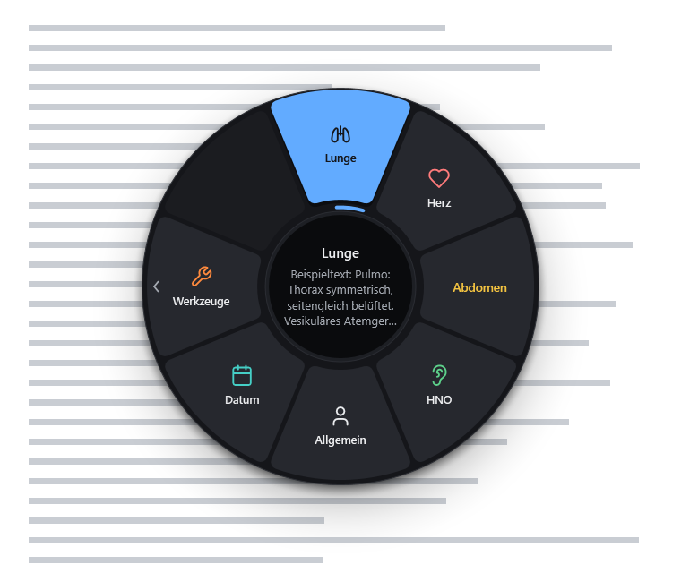
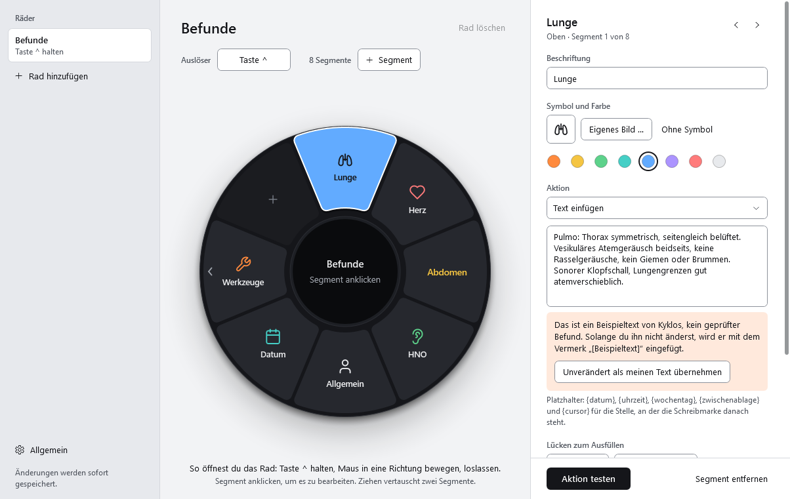

# Kyklos

Ein Auswahlrad für Windows: Taste halten, Maus in eine Richtung bewegen, loslassen – und der hinterlegte Text steht im
Feld, in dem der Cursor schon war. Gebaut für die Praxis, damit Normalbefunde und Textbausteine in unter einer Sekunde in
der Karteikarte stehen, ohne dass der Blick sie verlässt. Dazu Tastenkombinationen, Programme, Websites, Medientasten,
Makros und Unterräder – eine frei belegbare Schaltzentrale, bedient wie ein Auswahlrad aus Computerspielen.



Ein Projekt von [Asklaion](https://asklaion.de) – kostenlose Programme von einem Hausarzt für Arztpraxen. Kostenlos und
quelloffen unter der MIT-Lizenz. „Kyklos" ist griechisch für Kreis bzw. Rad.

## Herunterladen

**[Kyklos.exe aus dem neuesten Release laden](https://github.com/lollylan/Kyklos/releases/latest)** – eine einzelne Datei
(ca. 470 KB), keine Installation, keine Administratorrechte. Läuft auf jedem Windows 10/11 (nutzt das in Windows
enthaltene .NET Framework 4.8).

Die Exe in einen eigenen Ordner legen (z. B. `Dokumente\Kyklos` oder auf einen USB-Stick); die Konfiguration entsteht
daneben. Weil die Exe nicht signiert ist, warnt Windows beim ersten Start einer heruntergeladenen Datei: bei SmartScreen
auf „Weitere Informationen" → „Trotzdem ausführen" klicken, oder vorher in den Dateieigenschaften „Zulassen" anhaken.
Mehr dazu unter [Grenzen](#grenzen).

## Benutzen



1. `Kyklos.exe` starten. Beim ersten Start öffnen sich die Einstellungen, danach sitzt das Programm im Infobereich
   neben der Uhr (Linksklick: Einstellungen, Rechtsklick: Pausieren / Beenden).
2. In ein Textfeld klicken, **`^` halten** (die Taste links oben unter Esc) – das Rad erscheint am Mauszeiger.
3. Maus in Richtung eines Segments bewegen. Die Taste leuchtet, die Mitte zeigt, was gleich eingefügt wird.
4. **Loslassen** löst aus. Zeiger und Zwischenablage sind danach wieder wie vorher.

| Geste | Wirkung |
|---|---|
| Halten, Richtung, loslassen | Segment auslösen – die Auswahl gilt ab der Mitte beliebig weit nach außen |
| In der Mitte loslassen, Esc oder Rechtsklick | Abbrechen |
| Kurz antippen | Rad bleibt offen; ein Linksklick wählt (abschaltbar unter *Allgemein*) |
| Über den Außenrand eines Unterrad-Segments fahren oder kurz darauf verweilen | Unterrad öffnet sich am Zeiger |

`Umschalt + ^` (das Gradzeichen °) und alle anderen Kombinationen mit `^` funktionieren weiter; nur die Taste allein
öffnet das Rad. Wer `^` selbst braucht, legt in den Einstellungen einen anderen Auslöser fest.

## Einrichten

Links die Räder, in der Mitte das Rad zum Anklicken, rechts das gewählte Segment. Alles wird sofort gespeichert und gilt
sofort.

- **Auslöser** pro Rad: einzelne Taste, Kombination (z. B. Strg + Leertaste), Maus-Seitentaste oder mittlere Maustaste.
  Schaltfläche anklicken, Taste drücken. Über **Zweiter Auslöser** öffnet dasselbe Rad auch mit einer weiteren Taste oder
  Kombination (z. B. `^` oder Strg + Leertaste); das × daneben entfernt ihn wieder.
- **Gilt in** – ein Rad kann auf bestimmte Programme beschränkt werden, etwa ein Dokumentationsrad nur für die
  Praxissoftware und ein Rad mit Ablegen, Antworten und Weiterleiten nur für das E-Mail-Programm. Unter *Gilt in* auf
  „Auf ein Programm beschränken …" klicken und das Programm aus der Liste der gerade offenen Fenster wählen; Exe-Namen
  muss niemand kennen. Mehrere Räder dürfen dieselbe Taste haben: `^` öffnet dann in der Praxissoftware deren Rad und
  überall sonst das allgemeine. Gibt es kein allgemeines Rad mit dieser Taste, bleibt sie in anderen Programmen eine
  ganz normale Taste. Weil ein Browser jede Website zeigt, lässt sich zusätzlich ein Teil des Fenstertitels eintragen
  (z. B. „Gmail"). Erkannt wird am Namen der Exe, deshalb passt die Konfiguration auch auf einem anderen PC.
- **Rad duplizieren** legt eine Kopie mit allen Segmenten, Unterrädern und Makros an – ohne Auslöser, damit sie eine
  eigene Taste bekommt. Praktisch für leicht abgewandelte Räder, etwa eins pro Kollegin am selben PC.
- **Segmente**: 2 bis 12 pro Rad. Ziehen vertauscht zwei Segmente, die Pfeile im Inspektor verschieben eins.
- **Beschriftung, Symbol, Farbe**: Text und/oder Symbol aus der Auswahl oder ein eigenes Bild (PNG, JPG, ICO … oder das
  Symbol einer Exe). Bilder werden verkleinert in der Konfiguration abgelegt.
- **Aktion testen** startet nach 3 Sekunden – in dieser Zeit ins Zielfeld klicken.
- **Aussehen** unter *Allgemein*: Graphit (dunkel, Standard), Hell, Milchglas (der Bildschirm schimmert weichgezeichnet
  durch das Rad), Halloween (in der Mitte ein Auge, das dem Mauszeiger folgt) und Weihnachten (Lichterkette, Schnee,
  Schneekugel in der Mitte).

### Aktionen

| Aktion | Was passiert |
|---|---|
| Text einfügen | Fügt den Text über die Zwischenablage ein (schnell, sicher bei Umlauten und langen Texten) oder tippt ihn Zeichen für Zeichen, falls ein Programm Einfügen sperrt |
| Tastenkombination | Sendet z. B. Strg + S |
| Programm, Datei oder Ordner öffnen | Auch mit Parametern; `%USERPROFILE%` und andere Umgebungsvariablen werden aufgelöst |
| Website öffnen | Im Standardbrowser |
| Medien und System | Wiedergabe, Lautstärke, Bildschirmausschnitt, [Text erkennen](#text-erkennen), Desktop anzeigen, PC sperren |
| Makro | Mehrere der obigen Schritte nacheinander, mit Pausen und Mausklicks (links, doppelt, rechts, Mitte) an einem festen Bildschirmpunkt. „Position aufnehmen" gibt 3 Sekunden, um den Zeiger auf das Ziel zu stellen; nach dem Klick steht der Zeiger wieder, wo er war. Zuverlässiger als ein Klick ist der Schritt „Fenster nach vorn holen“: Er sucht das zuletzt benutzte Fenster eines Programms (optional mit Teil des Titels), holt es auch verdeckt oder minimiert nach vorn und startet das Programm bei Bedarf. Findet er keins, bricht das Makro ab, damit die folgenden Tasten nicht im falschen Programm landen |
| KI-Anweisung | Schickt markierten Text mit einer Anweisung an ein Sprachmodell (Ollama, OpenAI, Anthropic, OpenRouter) und legt das Ergebnis in die Zwischenablage oder ersetzt die Markierung – siehe [KI-Anweisungen](#ki-anweisungen) |
| Unterrad | Ein weiteres Rad hinter diesem Segment |

Platzhalter im Text: `{datum}` (03.10.2026), `{uhrzeit}` (14:32), `{wochentag}`, `{zwischenablage}` (aktueller Inhalt) und
`{cursor}` – dort steht nach dem Einfügen die Schreibmarke.

### Lückentext

Lücken werden erst beim Auslösen gefüllt. Die Schaltflächen „Eingabefeld", „Mehrfachauswahl" und „Entweder-oder" unter
dem Text setzen sie an die Schreibmarke (markierter Text wird zum Namen der Lücke).

```
Erkältungssymptome seit {?Tage} Tagen mit {?Symptome: Husten | Schnupfen | Heiserkeit | Kopfschmerzen}.
FSME-Impfung aktuell: {?FSME-Impfung: ja / nein / unbekannt}.
```

Optionen mit `|` getrennt lassen sich beliebig ankreuzen, mit `/` getrennt ist genau eine wählbar. Ein Schrägstrich
zwischen zwei Ziffern (`1/2`, `5/10 mg`) trennt keine Optionen.

Beim Auslösen öffnet sich am Zeiger ein Fenster: oben der Text, wie er gleich eingefügt wird (die Lücke, an der du gerade
bist, leuchtet in der Segmentfarbe), darunter die Felder. Angekreuzte Optionen werden zu „Husten, Schnupfen und
Kopfschmerzen" verbunden. Steht dieselbe Lücke mehrmals im Text, wird sie einmal abgefragt.

| Taste | Wirkung |
|---|---|
| Tab / Umschalt + Tab | Nächstes / voriges Element (jede Option einzeln, Entweder-oder als Ganzes) |
| Leertaste | Option an / aus |
| Pfeil hoch / runter | Zwischen Optionen wechseln; bei Entweder-oder zugleich wählen |
| Enter | Zur nächsten Lücke; in der letzten: einfügen |
| Strg + Enter | Sofort einfügen |
| Esc | Abbrechen, nichts wird eingefügt |

Danach geht der Fokus an das Programm zurück, in dem du warst, und der Text landet an der Schreibmarke.

### Abwechslung

Damit bei Normalbefunden nicht in jeder Karteikarte wortgleich derselbe Baustein steht, kann ein Text mehrere Fassungen
haben. Eine Zeile `{oder}` trennt sie; beim Auslösen wird eine davon zufällig eingefügt, nie zweimal hintereinander
dieselbe. Mitten im Satz wechselt `{~… | …}` einzelne Formulierungen:

```
Hausbesuch: Patient in seinem Grundzustand unverändert, keine neuen Beschwerden.
{oder}
Hausbesuch: Zustand gegenüber dem letzten Besuch {~unverändert | stabil}, keine Auffälligkeiten.
{oder}
Hausbesuch ohne Auffälligkeiten, Patient {~beschwerdefrei | ohne neue Beschwerden}.
```

Die Schaltflächen „Weitere Variante" und „Wechselnde Formulierung" unter dem Text setzen beides ein. Das Rad zeigt in der
Mitte die erste Fassung und wie viele es gibt. Lücken (`{?…}`) dürfen in jeder Fassung stehen; abgefragt wird nur die
gewählte.

## Text erkennen

Für Arztbriefe, die als Fax oder Scan kommen: das Wichtige am Bildschirm markieren und als Text in die Karteikarte
übernehmen. Die Aktion steht unter *Medien und System* (im Beispielrad unter *Werkzeuge*).

1. Segment auslösen – der Bildschirm unter dem Zeiger wird eingefroren und abgedunkelt.
2. Mit gedrückter linker Maustaste einen Rahmen um den Text aufziehen. Esc oder Rechtsklick bricht ab.
3. Der erkannte Text liegt in der Zwischenablage, eine kleine Tafel am Zeiger zeigt die ersten Zeilen zum Gegenlesen.
   Der Fokus ist wieder im Programm von vorher; `Strg + V` fügt ein.

Zeilenumbrüche bleiben wie im Brief, ein größerer Abstand zwischen zwei Zeilen wird zur Leerzeile. Erkannt wird mit der
in Windows eingebauten Texterkennung: **alles bleibt auf dem PC**, nichts geht ins Internet. Wie bei den Bausteinen wird
der Zwischenablage-Verlauf (Win + V) gebeten, den Text nicht aufzuzeichnen.

Im Makro lässt sich direkt weitermachen, etwa: *Text erkennen* → *Fenster nach vorn holen* (Praxissoftware) →
Tastenkombination `Strg + V`. Wird die Auswahl abgebrochen oder kein Text erkannt, hält das Makro an, statt den alten
Inhalt der Zwischenablage einzufügen.

**Gegenlesen bleibt Pflicht**, vor allem bei Dosierungen und Zahlen. Kyklos liest jeden Ausschnitt mehrfach – so wie er
ist und mit nachgezogenen Strichen, denn im Fax-Modus „Normal" brechen dünne Querstriche und Serifen weg – und nimmt die
Lesart, die am ehesten nach Wörtern und Zahlen aussieht. Korrigiert wird dabei nichts. Bei Faxen in Serifen- oder
Schreibmaschinenschrift bleiben trotzdem Buchstabenfehler; dann hilft Tesseract (unten). Zeilen werden nach ihrer Lage
zusammengesetzt, sodass Tabellenzeilen (Wert, Einheit, Referenz) zusammenbleiben. Fehlt die deutsche Texterkennung in
Windows (selten), sagt die Tafel, wo sie sich nachinstallieren lässt.

### Genauer mit Tesseract (optional)

[Tesseract](https://github.com/tesseract-ocr/tesseract) ist eine quelloffene Texterkennung (Apache-Lizenz 2.0), die
ebenfalls nur auf dem PC läuft. Ist sie installiert, liest Kyklos jeden Ausschnitt zusätzlich damit und wählt die
plausiblere Lesart; die Tafel nennt dann, welche Erkennung gewonnen hat. Ohne Tesseract ändert sich nichts.

Gemessen an 36 simulierten Faxen (Zeichenfehler, weniger ist besser):

| Fax | nur Windows | mit Tesseract |
|---|---|---|
| Serifenschrift (Times), Modus „Normal" | 38 % | 20 % |
| Schreibmaschine (Courier), Modus „Normal" | 82 % | 44 % |
| Serifenlos (Arial) oder Modus „Fein" | 0,5–6 % | 0,5–5 % |

Einrichten:

1. Tesseract für Windows installieren, z. B. über den Installer der [UB Mannheim](https://github.com/UB-Mannheim/tesseract/wiki).
   Kyklos findet es unter `Programme\Tesseract-OCR`, `AppData\Local\Programs\Tesseract-OCR`, im Suchpfad oder in einem
   Ordner `Tesseract-OCR` neben `Kyklos.exe`.
2. Das deutsche Sprachmodell `deu.traineddata` aus
   [tessdata_fast](https://github.com/tesseract-ocr/tessdata_fast/raw/main/deu.traineddata) (1,5 MB) in einen Ordner
   `tessdata` neben `Kyklos.exe` legen – das geht ohne Administratorrechte. Alternativ beim Installer „German"
   mitinstallieren. Die Variante „fast" war im Test genauer als „best" und die Standardvariante.

Das Bild geht über eine Pipe an Tesseract, nicht über eine Datei; nichts davon landet auf der Festplatte.

## KI-Anweisungen

Markierten Text von einem Sprachmodell bearbeiten lassen: zusammenfassen, ausführlicher formulieren, korrigieren oder
aus einem Arztbrief die Untersuchungen nach festem Schema herausziehen. Die Aktion heißt *KI-Anweisung*.

1. Text markieren, Rad öffnen, Segment wählen. Kyklos kopiert die Markierung (`Strg + C`) und schickt sie mit der
   Anweisung an das Modell. Das Rad ist sofort wieder frei, eine Tafel am Zeiger zeigt „KI arbeitet …“.
2. Ist das Modell fertig, meldet sich die Tafel dort, wo der Zeiger gerade ist, mit den ersten Zeilen des Ergebnisses.

Was dann mit dem Ergebnis passiert, legt jedes Segment fest:

| Ergebnis | Wann |
|---|---|
| In die Zwischenablage legen | Text aus einem Programm holen und in ein anderes einfügen: mit `Strg + V`, sobald die Tafel „Fertig“ meldet |
| Markierung direkt ersetzen | Text an Ort und Stelle umschreiben. Ersetzt wird nur, wenn noch dasselbe Feld aktiv ist – sonst liegt das Ergebnis in der Zwischenablage und die Tafel sagt es |

Statt der Markierung kann auch der Inhalt der Zwischenablage die Quelle sein – etwa im Makro *Text erkennen* → *KI-Anweisung*,
das ein gefaxtes Arztbrief-Stück direkt auswertet. Im Makro wartet der nächste Schritt, bis die KI fertig ist.

Die Anweisung ist frei formulierbar, auch mehrzeilig mit Schema. *Vorlage einsetzen* bietet Anfänge: Zusammenfassen,
Ausführlicher, Korrigieren, Freundlicher, Für Patienten erklären, Arztbrief: Untersuchungen, Arztbrief: Diagnosen und
Medikation. Kyklos ergänzt jede Anweisung um feste Regeln: nur das Ergebnis ausgeben, kein Markdown, nichts erfinden.
**Gegenlesen bleibt Pflicht** – ein Sprachmodell kann Befunde weglassen oder falsch zuordnen.

### Anbieter

Unter *Allgemein › KI-Anbieter*:

- **Ollama** – auf diesem PC oder auf einem Rechner im Praxisnetz (Adresse eintragen, z. B. `192.168.178.20`; dort muss
  Ollama mit `OLLAMA_HOST=0.0.0.0` laufen). *Modelle laden* zeigt die dort installierten Modelle. Die Texte verlassen
  die Praxis nicht. Kyklos schaltet das „Nachdenken“ von Reasoning-Modellen ab, damit kurze Aufgaben schnell gehen, und
  vergrößert das Kontextfenster bei langen Briefen, damit Ollama nichts abschneidet.
- **OpenAI (ChatGPT)**, **Anthropic (Claude)** und **OpenRouter** – Dienste im Internet, mit eigenem API-Schlüssel.

Ein Anbieter ist der Standard; jedes Segment kann einen anderen wählen. *Verbindung testen* schickt nur einen festen
Prüftext.

> **Externe Anbieter: unter keinen Umständen Patientendaten.** Alles, was an OpenAI, Anthropic oder OpenRouter geht,
> verlässt die Praxis (ärztliche Schweigepflicht § 203 StGB, DSGVO Art. 9). Kyklos warnt beim Hinzufügen, beim Anbieter
> und bei jedem Segment, das ihn nutzt. Als extern gilt auch ein Ollama mit Adresse außerhalb des eigenen Netzes oder
> mit einem Cloud-Modell (`…-cloud`).

Der Schalter **Nur lokal ausführen** sperrt ein Segment gegen jeden externen Anbieter – auch wenn später jemand den
Standard umstellt. Die Arztbrief-Vorlagen setzen ihn automatisch. Ein lokaler Anbieter wird beim Hinzufügen Standard,
wenn bisher nur externe eingerichtet sind.

**API-Schlüssel** werden mit der Windows-Datenschutz-API (DPAPI) für das angemeldete Benutzerkonto verschlüsselt und in
`Kyklos.keys` neben der Konfiguration abgelegt – nie in `Kyklos.json`, also auch in keinem Export und keinem geteilten
Rad. Angezeigt werden nur die letzten vier Zeichen. Auf einem anderen PC oder unter einem anderen Konto lässt sich die
Datei nicht entschlüsseln; dort den Schlüssel neu eintragen. Kyklos protokolliert keine Texte, nur Fehlermeldungen.

## Räder aus dem Internet

*Räder aus dem Internet …* in der Seitenleiste öffnet die Galerie: Räder anderer Anwender mit Vorschau, Suche und einem
Klick zum Hinzufügen. Sie liegen im Ordner `galerie/` dieses Repos (`galerie/raeder/*.kyklos.json`, Liste in
`galerie/index.json`) und werden beim Öffnen von GitHub geladen.

Fremde Räder können Programme starten, Websites öffnen und Makros ausführen. Kyklos liest das aus dem Rad selbst
(nicht aus der Liste) und zeigt es vor dem Hinzufügen im Klartext. Räder nur mit Text, Tasten und Medien kommen ohne
Rückfrage.

Ein Rad beisteuern: im Rad-Kopf *Exportieren …*, der Datei einen Block `"galerie": { "autor", "beschreibung", "programm" }`
voranstellen, nach `galerie/raeder/` legen und `tools\galerie-index.ps1` ausführen (erzeugt `index.json`). Zum Ausprobieren
vor dem Veröffentlichen die Umgebungsvariable `KYKLOS_GALERIE` auf einen lokalen Ordner setzen.

## Dateien

| Datei | Zweck |
|---|---|
| `Kyklos.exe` | Das Programm. Mit `Kyklos.exe --quit` lässt sich eine laufende Instanz beenden. |
| `Kyklos.json` | Die Konfiguration, liegt neben der Exe (portabel). Ist der Ordner schreibgeschützt, unter `%APPDATA%\Kyklos`. Eine `Shortcut.json` aus der Zeit vor der Umbenennung wird beim ersten Start übernommen (kopiert). |
| `Kyklos.json.tmp` | Zwischendatei beim Speichern. Bleibt nur liegen, wenn ein anderes Programm (Virenscanner, Synchronisierung) die Konfiguration bis zum Beenden festgehalten hat – ihr Inhalt wird beim nächsten Start übernommen. |
| `Kyklos.log` | Entsteht nur, wenn etwas schiefgeht. |
| `Kyklos.keys` | API-Schlüssel für [KI-Anbieter](#anbieter), verschlüsselt für dein Windows-Konto. Nur auf diesem PC lesbar. |
| `tessdata\deu.traineddata` | Optional: deutsches Sprachmodell für [Tesseract](#genauer-mit-tesseract-optional). |

Zum Mitnehmen auf einen anderen PC genügen Exe und `Kyklos.json`.

Die mitgelieferten Befundtexte sind **Beispiele, keine geprüften Befunde**. Solange du einen nicht geändert oder in den
Einstellungen ausdrücklich übernommen hast, wird er mit dem Vermerk `[Beispieltext]` eingefügt.

## Grenzen

- Fenster von Programmen, die **als Administrator** laufen, schirmt Windows ab: Dort reagiert der Auslöser nicht und
  Text kommt nicht an – es sei denn, Kyklos wird ebenfalls als Administrator gestartet.
- Der Zwischenablage-Verlauf (Win + V) wird gebeten, Bausteine nicht aufzuzeichnen; daran halten sich Windows und die
  meisten, aber nicht alle Zwischenablage-Werkzeuge.
- Die Exe ist **nicht signiert**. Ist Smart App Control aktiv (Windows 11), kann Windows den Start mit „Eine
  Anwendungssteuerungsrichtlinie hat diese Datei blockiert" ablehnen. Windows entscheidet das für jede neu gebaute Datei
  einzeln: Beim Entwickeln wurden drei von neun Builds blockiert, einer nur für unter eine Minute, zwei dauerhaft –
  ohne erkennbaren Zusammenhang mit der jeweiligen Änderung. Die Exe im Release ist ein Build, den Windows beim
  Entwickeln zugelassen hat; nach jedem neuen Bauen kann das anders ausfallen. Kopien aus E-Mail oder Download lösen
  zusätzlich die SmartScreen-Warnung aus, per USB-Stick oder Netzlaufwerk kopierte nicht. Verlässlich wäre nur eine
  Code-Signatur.
- Zum Aktualisieren erst Kyklos im Infobereich beenden (oder `Kyklos.exe --quit`), dann die neue Exe an dieselbe Stelle
  legen und starten. Läuft noch die alte, holt die neue nur deren Einstellungen nach vorn und beendet sich gleich wieder.
- Nur Windows.
- Läuft die Praxissoftware per Fernzugriff (Remotedesktop, Citrix), sieht Kyklos nur das Fernzugriffsprogramm, nicht
  das Programm darin. Dann über einen Teil des Fenstertitels unterscheiden.
- Manche Virenscanner beäugen Programme, die Tastatur und Maus global beobachten. Kyklos liest nur mit, ob der
  Auslöser gedrückt ist, und speichert oder versendet nichts. Texte verlassen den PC nur bei einer KI-Anweisung, an
  den dafür eingerichteten Anbieter.

## Bauen

```powershell
powershell -ExecutionPolicy Bypass -File build.ps1
```

Das Ergebnis liegt in `dist\Kyklos.exe`. Braucht nur den C#-Compiler aus den „Build Tools für Visual Studio" (2019 oder
neuer); kein .NET SDK, kein Windows SDK, keine Pakete.
Ziel ist das in Windows enthaltene .NET Framework 4.8. Das Programmsymbol (`assets\app.ico`) zeichnet die App selbst –
fehlt es, erzeugt es der Build.

| Quelle | Inhalt |
|---|---|
| `src\WheelView.cs` | Zeichnet das Rad (Overlay und Vorschau) |
| `src\Overlay.cs` | Fenster am Zeiger, Ablauf Halten → Wählen → Auslösen |
| `src\InputHook.cs` | Globale Tastatur- und Maus-Hooks auf eigenem Thread |
| `src\ActionRunner.cs` | Aktionen, Texteingabe, Zwischenablage |
| `src\FillIn.cs` | Lückentext: Lücken erkennen und füllen, Abfragefenster mit Fokusübergabe |
| `src\TextCapture.cs` | Text erkennen: Bereich aufziehen, Vorverarbeitung und Windows-Texterkennung, Rückmeldung am Zeiger |
| `src\SettingsWindow.xaml/.cs`, `src\Theme.xaml` | Einstellungen und ihr Aussehen |
| `src\Model.cs`, `src\ConfigStore.cs`, `src\Json.cs` | Datenmodell, Laden/Speichern, Beispiel-Räder |
| `src\Dev.cs` | `--dev-render <ordner>` rendert Rad und Einstellungen als PNG zur Sichtprüfung, `--dev-icon <datei>` das Symbol, `--dev-ocr <bild>` erkennt den Text eines Bilds nach `<bild>.txt` |
| `tools\e2e.ps1` | Funktionstest mit echten Eingaben: startet die Exe mit einer Testkonfiguration, hält die Auslösetaste, bewegt die Maus und prüft, was im Testfenster ankommt (bewegt ca. 15 s lang den Mauszeiger) |
| `tools\galerie-index.ps1` | Erzeugt `galerie\index.json` aus den Rad-Dateien in `galerie\raeder` |
| `tools\import-icons.mjs` | Übernimmt weitere Liniensymbole aus Tabler oder Lucide, z. B. `node tools/import-icons.mjs tabler:bone=knochen`, und gibt die Einträge für `Icons.cs` aus |

## Lizenz

MIT-Lizenz, siehe [LICENSE](LICENSE). Die Liniensymbole stammen teils aus [Tabler Icons](https://tabler.io/icons) (MIT) und [Lucide](https://lucide.dev)
(ISC – inhaltlich gleichwertig zur MIT-Lizenz); die Organe ohne Vorlage (Schilddrüse, Leber, Magen, Darm, Harnwege, Uterus u. a.)
sind selbst im selben Raster gezeichnet. Wortlaut der Fremdlizenzen in [THIRD-PARTY-NOTICES.md](THIRD-PARTY-NOTICES.md).
Die Windows-Symbole der Symbolauswahl kommen aus der Systemschrift „Segoe Fluent Icons" bzw. „Segoe MDL2 Assets" und werden nicht mitgeliefert.
